# KerfLab

**Laser-cut boxes, trays, gears, jigs and all sorts of flat-pack bits, designed right in your browser.**

Pick a generator, nudge the numbers, spin it around in 3D, then grab a cut file that's ready for your
laser. No install, no account, no backend: it's a static site, and your design lives in the URL so
you can share it with a link.

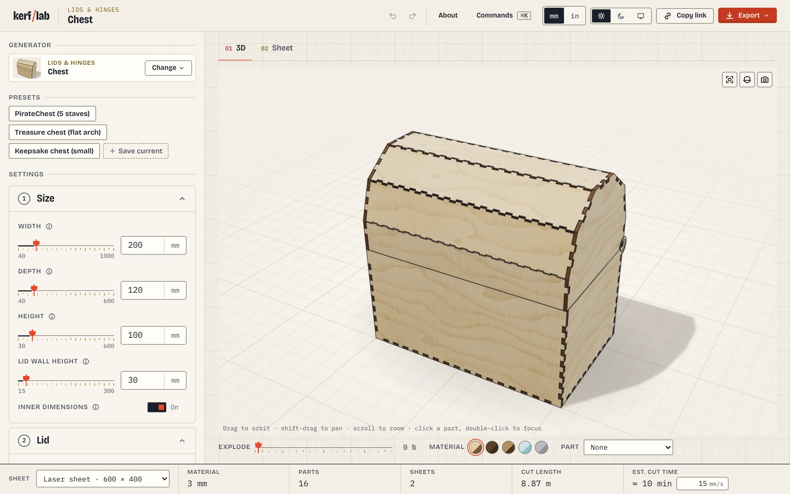

## What can it make?

67 generators so far, from plain boxes to gears and wall-mounted tool holders, each with presets to get you going.

<table>
  <tr>
    <td>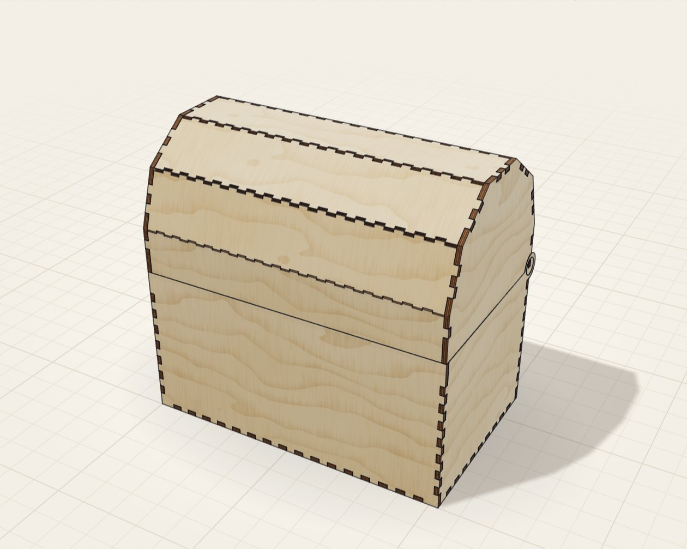</td>
    <td>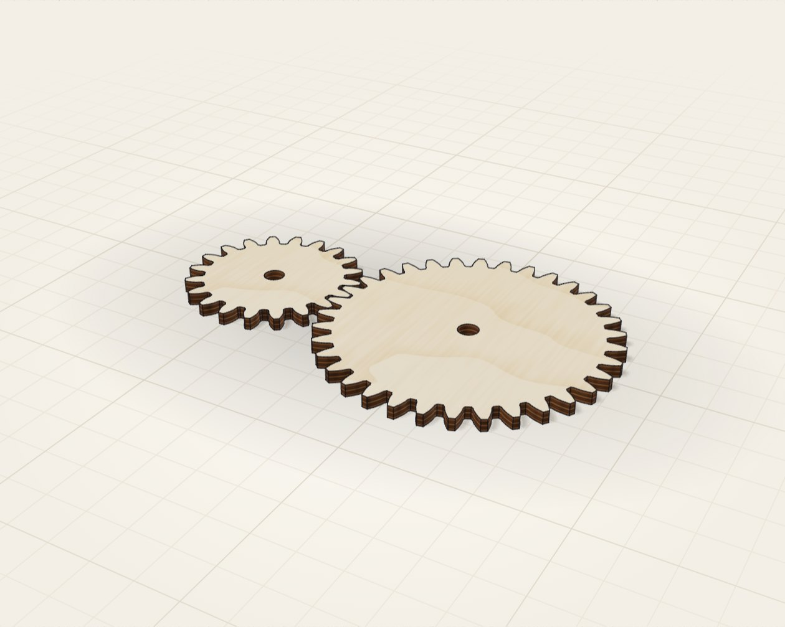</td>
    <td>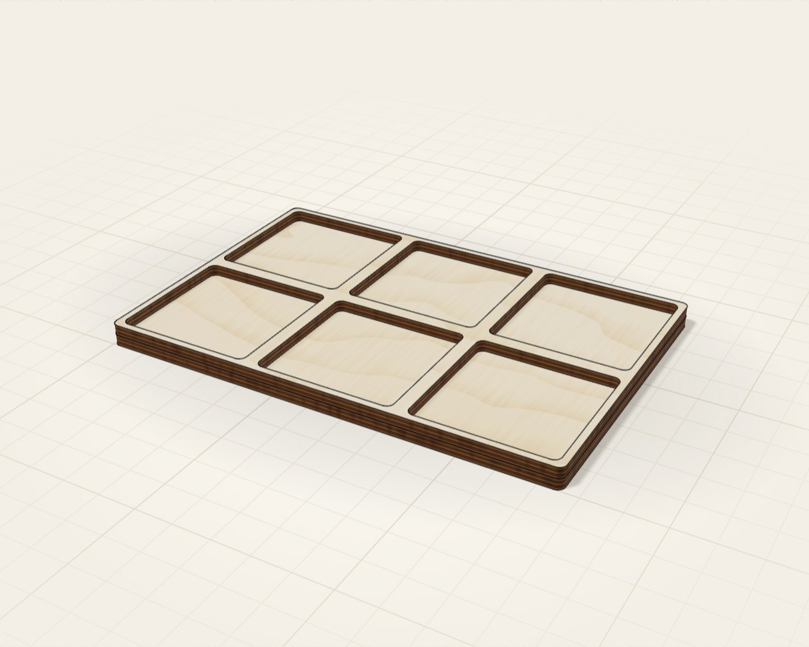</td>
    <td>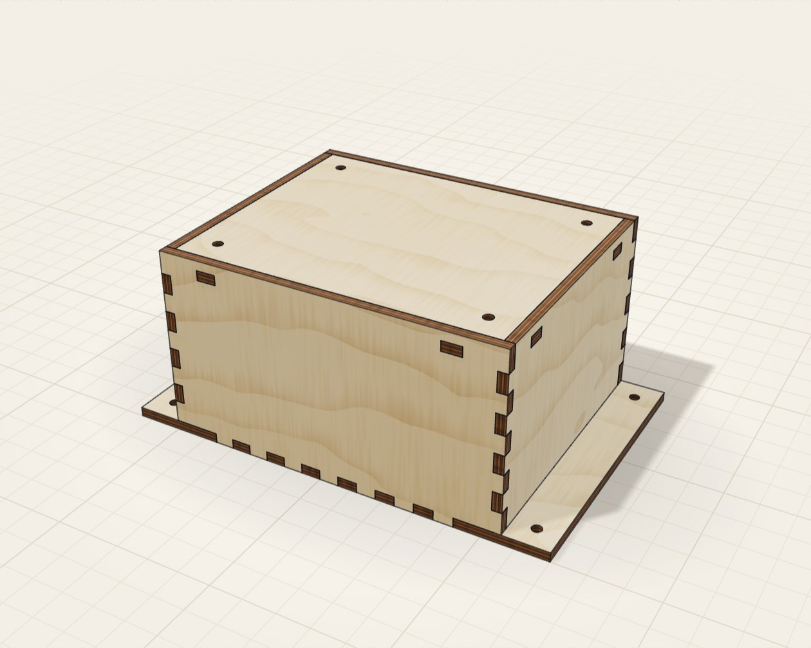</td>
  </tr>
  <tr>
    <td align="center">Chest</td><td align="center">Gears</td><td align="center">Gridfinity</td><td align="center">Enclosure</td>
  </tr>
  <tr>
    <td>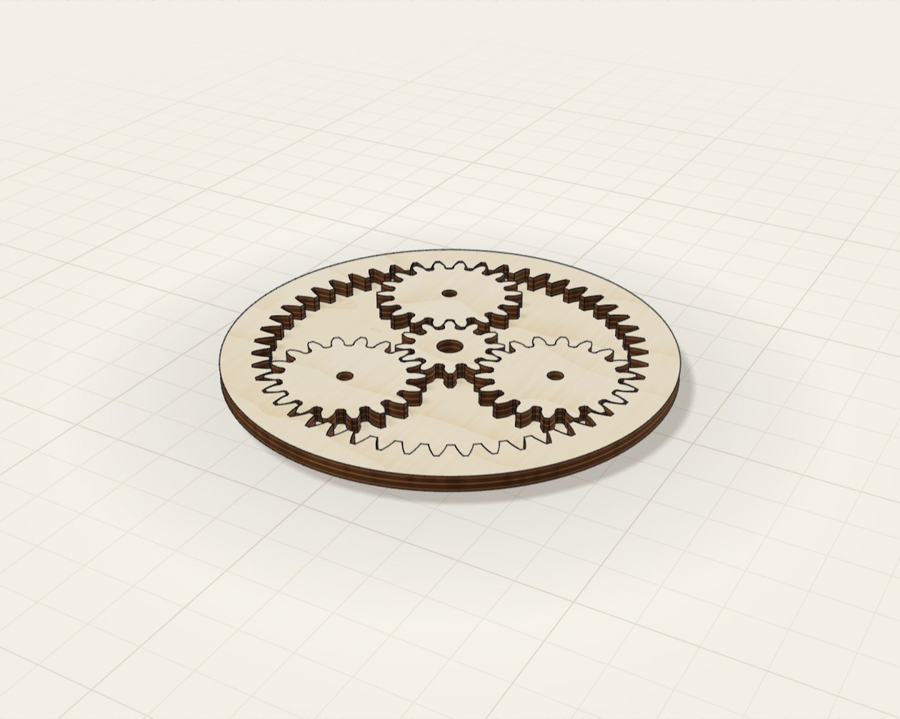</td>
    <td>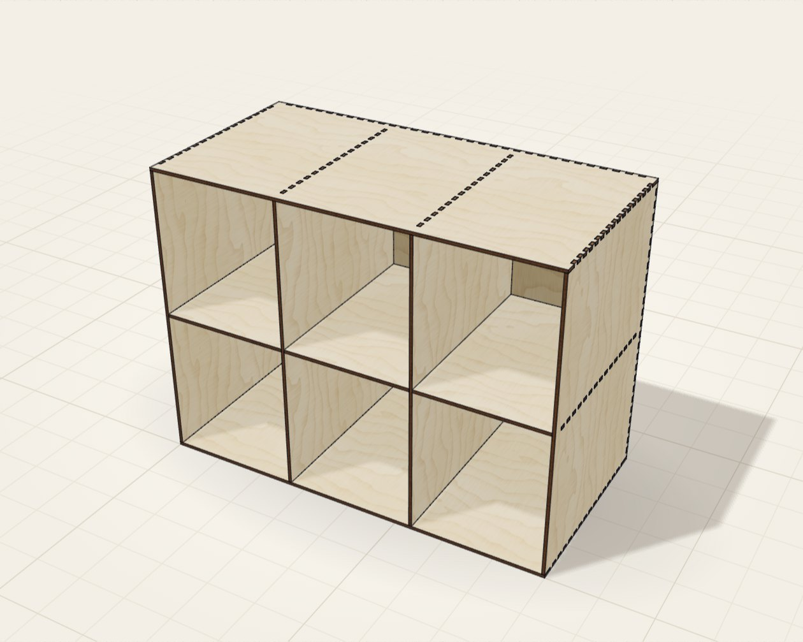</td>
    <td>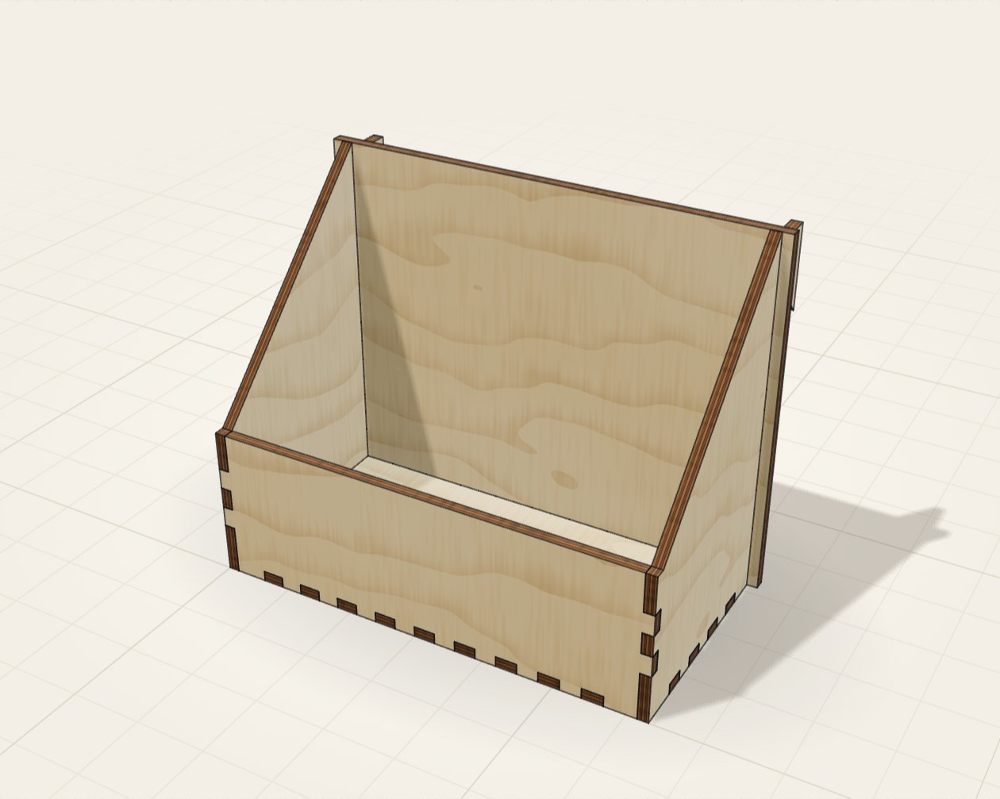</td>
    <td>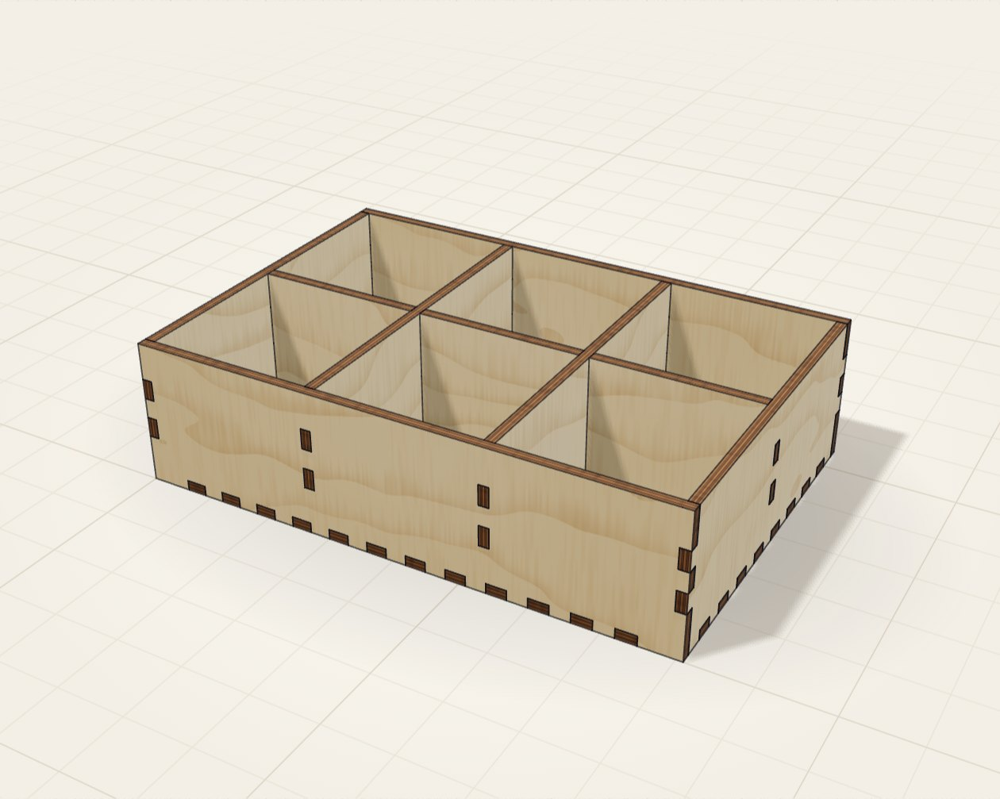</td>
  </tr>
  <tr>
    <td align="center">Planetary gears</td><td align="center">Storage shelf</td><td align="center">Wall holder</td><td align="center">Type tray</td>
  </tr>
</table>

## Standing on the shoulders of boxes.py

KerfLab is a reimagining of [boxes.py](https://github.com/florianfesti/boxes) by Florian Festi and its
many contributors, the brilliant open-source box generator that's been helping makers for years
(try it at [boxes.hackerspace-bamberg.de](https://boxes.hackerspace-bamberg.de)). Loads of the joint
geometry and generator ideas here come straight from it, so if KerfLab is useful to you, go show
boxes.py some love too.

It's not a line-by-line port, though. Generators follow boxes.py's logic where that makes sense,
a handful of flexible generic generators with named presets stand in for many one-off boxes.py
modules, and every generator is checked by a geometric test harness (fingers mate, nothing
overlaps, sizes match what you typed).

## Open source, and you're invited

KerfLab is free and open source under the GPL v3, same as boxes.py. Contributions of every size are
very welcome: bug reports, new generators, presets, docs, design tweaks, or just showing us what
you cut. Have a look at [CONTRIBUTING.md](CONTRIBUTING.md) to get going, and please be kind
([Code of Conduct](CODE_OF_CONDUCT.md)).

Not sure where to start? [docs/coverage.md](docs/coverage.md) lists the boxes.py generators we
haven't built yet. Pick one and say hi in an issue.

> Please check your cut files before you fire the laser, and never leave a laser running unattended.

## Features

<p>
  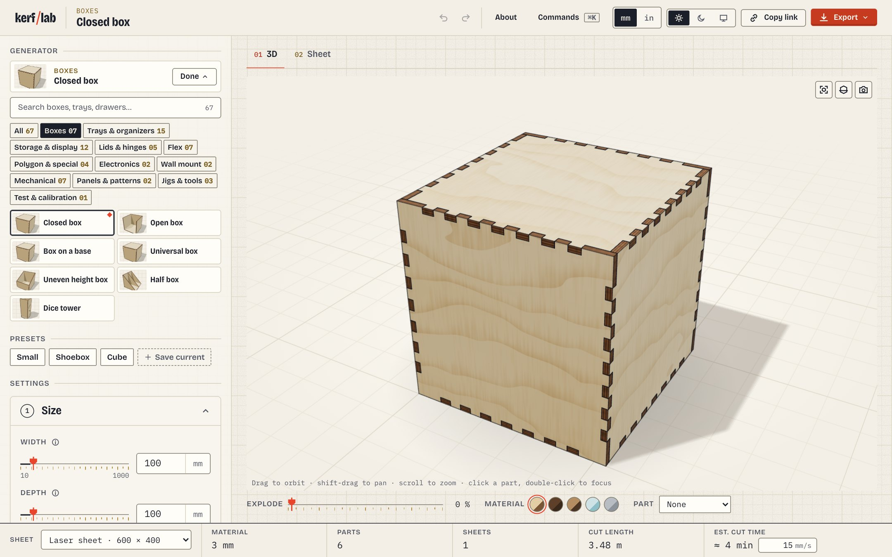
  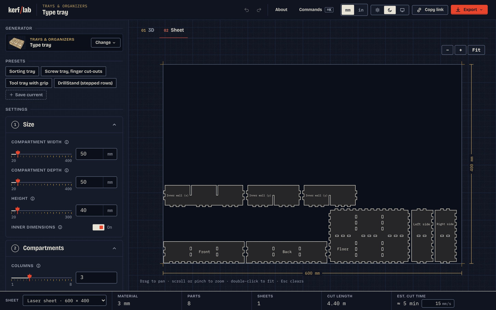
</p>

- **Generator picker**: 67 generators in 12 categories (Boxes, Trays & organizers, Storage &
  display, Lids & hinges, Flex, Polygon & special, Electronics, Wall mount, Mechanical, Panels &
  patterns, Jigs & tools, Test & calibration), search across all of them, and a small 3D
  thumbnail per tile (rendered once and cached; the cut-sheet drawing stays when WebGL is not
  available).
- **3D viewer**: the assembled object in birch ply, walnut ply, MDF, clear acrylic or aluminium;
  orbit, pan, zoom, explode slider, section cut, click a part to select it (in sync with the
  sheet), double-click to focus, save a PNG. three.js loads lazily, only when the 3D tab opens.
- **Sheet view**: parts nested on the laser bed, spilling onto further sheets when they do not
  fit, with part dimensions on selection. Bed sizes for common lasers (Glowforge, xTool, Epilog,
  K40, OMTech, ...) and paper/sheet formats, or a custom size; stock profiles set thickness and
  kerf together.
- **Export**: SVG (cut red, engrave blue, one file per sheet) and DXF (R12, CUT / ENGRAVE
  layers), kerf-compensated, in mm or inches; a cut-length and laser-time estimate.
- **Sharing**: the design lives in the URL hash (`#v1/<generator>/<changed params>`), so a link
  reproduces it.
- **Presets**: each generator ships named presets (many carry the boxes.py generator names, so
  searching "Rack19Box" or "BirdHouse" finds them); save your own in the browser.
- **Command palette** (Cmd/Ctrl-K) over every generator and action, undo/redo, light and dark
  themes, reduced motion, keyboard-only use; axe-checked against WCAG 2.2 AA.

## Usage

Requires Node `^20.19` or `>=22.12` (Vite 8).

```sh
npm install
npm run dev          # dev server, http://localhost:5173
npm run build        # static site in dist/
npm run check        # typecheck, lint, unit tests, production build
```

End-to-end tests (Playwright, Chromium; the 3D tests render on SwiftShader, no GPU needed):

```sh
npx playwright install chromium
npm run test:e2e                                            # everything: app, then 3d, then shots
npx playwright test --project=app                           # UI flows, layout, axe (fast)
npx playwright test --project=3d --no-deps                  # 3D viewer
npx playwright test --project=shots --no-deps --workers=4   # screenshot sweep, ~5 min
```

The `shots` project captures every generator's Sheet and 3D views in light and dark theme into
`artifacts/shots/<id>-<view>-<theme>.png` for visual review, and fails on any console error or
page error. `artifacts/` is git-ignored. The Playwright web server runs on port 5287.

## Architecture

```
src/core/        geometry and the generator contract; no DOM
  geometry.ts      paths (lines + arcs), transforms, offsetting, bounds
  turtle.ts        boxes.py-style turtle for drawing outlines
  edges/           edge types: finger joints, slots, hinges, flex, mitre, click-in, ...
  part.ts          Part (outline, holes, 3D placement, mates) and the Generator interface
  schema.ts        typed parameter schema (number, int, bool, enum, text), defaults, validation
  livinghinge.ts   bent parts and living-hinge patterns; gear.ts: involute gears
src/generators/  one file per generator plus shared helpers (walls.ts, ...); index.ts is the registry
src/app/         the browser app
  store.ts, url.ts, history.ts   state, URL hash encoding, undo/redo
  build.ts         validate -> build -> nest, failures turned into messages
  export/          nesting (nest.ts), SVG and DXF writers
  views/           2D sheet (layout2d.ts), 3D viewer (viewer3d.ts, lazy chunk), assembly meshes
  ui/              picker, settings form, presets, palette, toasts, design tokens and CSS
tests/           Vitest unit tests and the registry-wide harness (tests/harness, tests/generators);
                 Playwright end-to-end specs in tests/e2e
scripts/         compare-boxespy.py (+ export-svg.mjs): optional comparison with boxes.py
docs/            coverage.md, differences.md, cut-list.md, design/ (the original design brief)
```

Data flow: the settings form edits params in the store; `runBuild` validates them against the
generator's schema, calls `generator.build(params)` for a `Part[]` (each part with its outline,
holes and 3D placement) and nests the parts on the sheet. The Sheet view and the exporters draw
the nested layout; the 3D viewer extrudes each part's nominal outline and places it in the
assembly.

## Adding a generator

1. Create `src/generators/<id>.ts` exporting a `Generator` (`id`, `name`, `category`,
   `description`, `schema`, `presets`, `build`, ideally `expectedSize`). `closedbox.ts` documents
   the reference pattern: own params then `...commonParams`; derive inner sizes; throw
   `ParamError` naming the offending key for infeasible input; draw panels with the wall helpers
   and place them in world space; finish with kerf.
2. Add one import and one entry to the `registry` array in `src/generators/index.ts`.
3. Add a headline-dimension test to the matching `tests/generators/<batch>.test.ts`.

The registry-wide harness covers it automatically (`tests/generators/suite.ts`, run in parallel
shards): every part is a valid simple outline with its holes inside, kerf compensation applies
cleanly, every finger edge mates a complementary edge over the same span, no two parts
interpenetrate, the assembly is connected (unless declared `assembly: 'loose'`), the assembled
size equals `expectedSize` within 0.01 mm, every preset builds, and seeded fuzzing (defaults,
presets, min/max corners, per-key extremes, random sets) either builds valid output or raises a
`ParamError` with a usable message. Thumbnails, URL state, the picker, the palette and the
screenshot sweep pick it up from the registry with no further code. Record deliberate deviations
from boxes.py in `docs/differences.md` and update `docs/coverage.md`.

## Quality gates

- `npm run check`: `tsc --noEmit` (strict), ESLint with zero warnings, Vitest (unit tests, the
  generator harness and fuzzing, SVG / DXF / nesting tests, colour-contrast tokens), `vite build`.
- `npm run test:e2e`: Playwright flows (picker, form, URL sharing, presets, palette, export
  downloads, sheet view, 3D viewer with pixel read-back, WebGL fallbacks), axe audits with zero
  violations in light and dark themes (app shell, sheet tab, 3D tab, palette, component sandbox),
  reduced-motion checks, and the registry-wide screenshot sweep.
- Optional: `python3 scripts/compare-boxespy.py` compares per-part sizes and edge-segment counts
  with boxes.py for the generators mapped one-to-one. It prints "skipped" when boxes.py cannot be
  imported; point `BOXESPY_PATH` (or `--boxespy PATH`) at your boxes.py checkout. Results are in `docs/differences.md`.

## Coverage of boxes.py

boxes.py has 175 generator modules. [docs/coverage.md](docs/coverage.md) maps every one: 83 built,
35 partially covered by a generic generator, 22 in scope but not built yet, 35 out of scope
(bespoke single-product devices, demos, paper items, Eurorack). Deliberate simplifications are in
[docs/differences.md](docs/differences.md), dropped generators in
[docs/cut-list.md](docs/cut-list.md).

## License

GPL-3.0-or-later; see [LICENSE](LICENSE). boxes.py (by Florian Festi and contributors) is licensed
under the GNU GPL v3. KerfLab ports the geometry and logic of its generators, so it is a
derivative work and is distributed under the same license.

---

Made by [Ali Bross](https://forestofrods.com), built together with Claude Opus 5.5.
